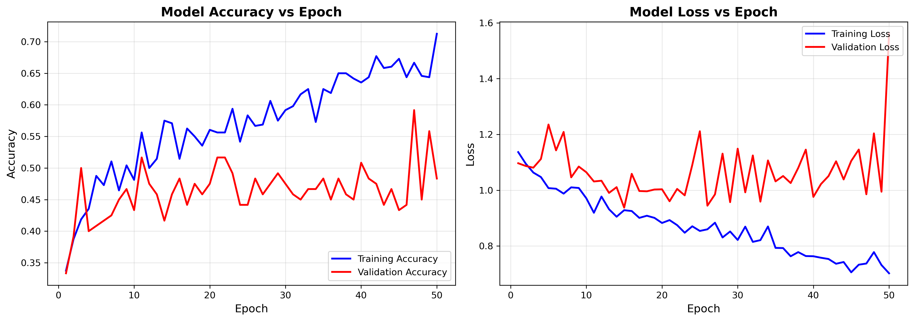
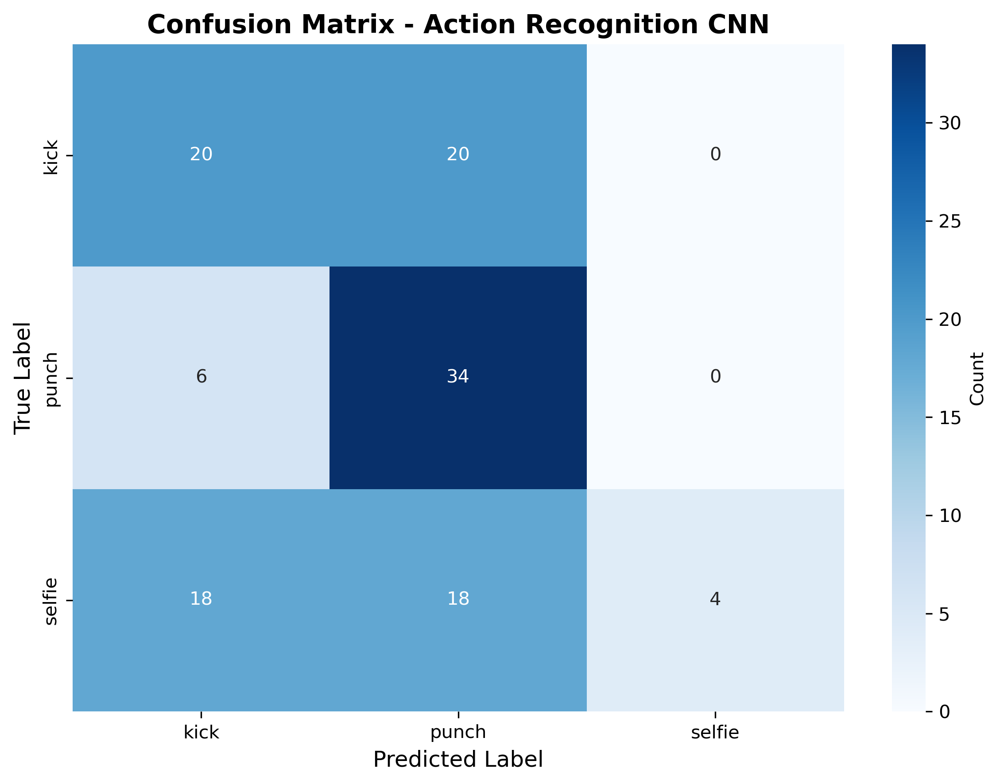

# 🥋 Action Recognition Using CNN

<p align="center">
  <b>Deep Learning-Based Human Action Classification Using Computer Vision</b>
</p>

<p align="center">
  
  
  
  
</p>

## 📌 About the Project

This project explores the application of deep learning in recognizing human actions from images using Convolutional Neural Networks (CNNs). It combines image classification techniques with a simple desktop interface to demonstrate how neural networks can identify different activities based on visual patterns.

The model is designed to classify three categories: Punch, Kick, and Selfie. A trained CNN processes the input image and predicts its corresponding action class. The project also incorporates a Tkinter-based graphical user interface, enabling users to upload images and view classification results.

Through this implementation, the project demonstrates key concepts in computer vision, supervised learning, image preprocessing, neural network training, and model evaluation.

## 🎯 Objectives

* Apply CNNs to image-based human action classification.
* Understand the process of preparing labelled image datasets.
* Develop and evaluate a deep learning classification model.
* Integrate model predictions into a desktop application.
* Explore practical applications of computer vision.

## ✨ Features

* Image-based action classification.
* CNN model developed using TensorFlow and Keras.
* Interactive desktop interface using Tkinter.
* Image upload and prediction functionality.
* Training history visualization.
* Confusion matrix for model evaluation.
* Saved model for subsequent inference.

## 📂 Dataset

The dataset contains labelled images belonging to three action categories:

* 👊 Punch
* 🦵 Kick
* 🤳 Selfie

The dataset is prepared for supervised learning, allowing the CNN to learn visual features associated with each class.

## 🛠️ Technologies Used

* Python
* TensorFlow and Keras
* NumPy and Pandas
* Matplotlib and Seaborn
* Scikit-learn
* Pillow (PIL)
* Tkinter

## 🧠 Model Architecture

The CNN architecture incorporates convolutional layers, ReLU activation, max pooling, flattening, dense layers, dropout, and a Softmax output layer.

The model uses the Adam optimizer and categorical cross-entropy loss, subject to the training configuration implemented in the notebook.

## 🔄 Workflow

1. Prepare and organize the labelled image dataset.
2. Preprocess images for model training.
3. Train the CNN to classify the selected actions.
4. Evaluate the model using training plots and a confusion matrix.
5. Save the trained model.
6. Load the model into the Tkinter application.
7. Upload an image and generate a prediction.

## 📊 Model Evaluation

The project includes training-history and confusion-matrix visualizations to examine model learning and classification performance.

### Training History



### Confusion Matrix



Actual evaluation metrics should be reported from the trained model's results.

## 🚀 Getting Started

Clone the repository:

```bash
git clone https://github.com/YOUR-USERNAME/Action-Recognition-Using-CNN.git
cd Action-Recognition-Using-CNN
```

Install the dependencies:

```bash
pip install -r requirements.txt
```

Launch the application:

```bash
python app.py
```

Ensure the trained model and required dependencies are available before launching the application.

## 🔮 Future Scope

* Extend recognition to additional human actions.
* Explore video-based action recognition.
* Integrate webcam-based predictions.
* Experiment with transfer learning architectures.
* Improve model generalization through data augmentation.
* Develop a web-based interface for easier accessibility.

## 👨‍💻 About Me

**Mohammed Khaleel Khan**

Computer Science and Engineering Graduate | Aspiring AI/ML Professional

Interested in artificial intelligence, machine learning, computer vision, and building practical technology solutions.

My focus is on understanding how AI models work, applying them to real-world problems, and translating technical concepts into useful applications.

**Areas of Interest:** Artificial Intelligence • Machine Learning • Deep Learning • Computer Vision

## 📜 License

Refer to the repository's `LICENSE` file for licensing terms.
